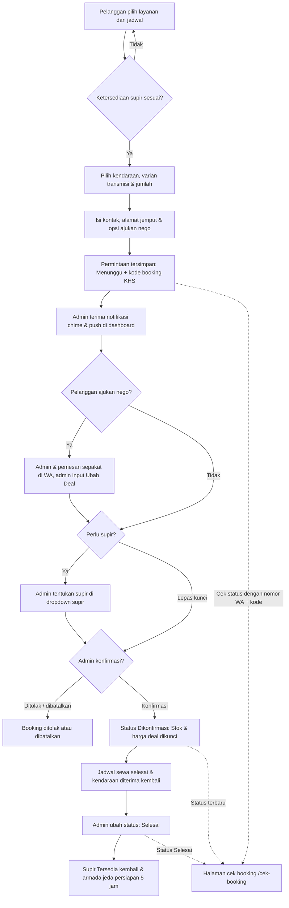

# Rencana Anggaran Biaya (RAB)
## Website Rental Mobil PT Khalisa Sumber Rezeki
### Skema Penawaran Khusus: Rp2.500.000 – Rp3.000.000

**Tanggal penyusunan:** 2 Oktober 2026  
**Tanggal pembaruan & penyesuaian:** 30 Oktober 2026  
**Jenis anggaran:** Penawaran paket investasi implementasi website dan dashboard operasional  
**Status domain:** Domain kustom `khalisarental.id` aktif untuk periode 5 tahun (Rp1.100.000 / 5 tahun dibayar terpisah oleh pemilik)  
**Status hosting & database:** Bebas biaya bulanan (Rp0 / bulan menggunakan arsitektur serverless Vercel & Supabase Cloud)

---

## 1. Ringkasan Skema Penawaran (Rp2.500.000 vs Rp3.000.000)

Tersedia 2 (dua) opsi paket yang disesuaikan dengan kebutuhan dan efisiensi anggaran PT Khalisa Sumber Rezeki:

| Komponen Fitur & Layanan | Opsi A: Paket Standard (Rp2.500.000) | Opsi B: Paket Pro Lengkap ⭐ (Rp3.000.000) |
|---|:---:|:---:|
| **Nilai Jasa Sistem** | **Rp2.500.000** *(Sekali bayar)* | **Rp3.000.000** *(Sekali bayar)* |
| **Katalog Armada & Spesifikasi Lengkap** | Termasuk | Termasuk |
| **Varian Transmisi (Matic/Manual) & Mesin (Bensin/Hybrid/EV)** | Termasuk | Termasuk |
| **Formulir Booking Cerdas (Jam/Hari/Bulan, Tol, GPS)** | Termasuk | Termasuk |
| **Fitur Negosiasi Harga ("Bisa Nego" & Quick Button WA)** | Tidak termasuk (Harga tetap) | **Termasuk Penuh** |
| **Fitur "Ubah Deal" Harga Nego di Admin** | Tidak termasuk | **Termasuk Penuh** |
| **Dashboard Admin Manajemen Armada & Supir** | Termasuk | Termasuk |
| **Notifikasi Audio Chime & Web Push Real-time** | Tidak termasuk (Cek manual) | **Termasuk Penuh (Bel audio + Push desktop)** |
| **Rekap Keuangan Jakarta Time & Ekspor Excel (.xlsx)** | Termasuk | Termasuk |
| **Halaman Cek Status Booking Mandiri (`/cek-booking`)** | Termasuk | Termasuk |
| **Proteksi Keamanan Database (RLS & Anti-Brute Force)** | Termasuk | Termasuk |
| **Garansi Bug Teknis** | 30 Hari Kalender | 30 Hari Kalender |
| **Biaya Domain Kustom (Aktif 5 Tahun Penuh)** | Rp1.100.000 | Rp1.100.000 |
| **Biaya Hosting & Server Bulanan** | **Rp0 (Gratis)** | **Rp0 (Gratis)** |
| **TOTAL INVESTASI (5 TAHUN BERJALAN)** | **Rp3.600.000** | **Rp4.100.000** |
| **Beban Biaya per Tahun** | **~Rp720.000 / tahun** | **~Rp820.000 / tahun** |
| **Beban Biaya per Bulan** | **~Rp60.000 / bulan** | **~Rp68.000 / bulan** |

---

## 2. Rincian Pekerjaan Teknis — Opsi A: Paket Standard (Rp2.500.000)

Total waktu pengerjaan: **49 jam kerja** (rata-rata tarif dasar Rp51.000 / jam):

| No. | Uraian pekerjaan teknis | Estimasi waktu | Tarif dasar | Jumlah |
|---:|---|---:|---:|---:|
| 1 | Analisis kebutuhan alur bisnis rental, struktur data varian, dan inventarisasi halaman | 4 jam | Rp50.000 | Rp200.000 |
| 2 | Desain antarmuka UI/UX modern, responsif ponsel & desktop, dan penataan komponen | 5 jam | Rp60.000 | Rp300.000 |
| 3 | Katalog armada cerdas, pengelompokan varian model, badge Promo/Terlaris, dan modal detail | 9 jam | Rp50.000 | Rp450.000 |
| 4 | Formulir booking fleksibel (durasi jam/hari/bulan min. 12 jam, tol otomatis, GPS & alamat Geoapify) | 8 jam | Rp50.000 | Rp400.000 |
| 5 | Dashboard operasional `/admin`: CRUD armada/foto cloud, rekap keuangan, filter jadwal, dan ekspor Excel | 10 jam | Rp50.000 | Rp500.000 |
| 6 | Integrasi Supabase PostgreSQL, autentikasi admin server-claims, dan kontrol akses RLS | 6 jam | Rp50.000 | Rp300.000 |
| 7 | Pengujian sistem, perbaikan bug tipe data, dan proteksi anti brute-force login | 4 jam | Rp50.000 | Rp200.000 |
| 8 | Konfigurasi deployment Vercel, setup domain `khalisarental.id`, SEO Google, dan serah terima | 3 jam | Rp50.000 | Rp150.000 |
|  | **Total Jasa Opsi A (49 jam)** |  |  | **Rp2.500.000** |

---

## 3. Rincian Pekerjaan Teknis — Opsi B: Paket Pro Lengkap (Rp3.000.000)

Mencakup seluruh modul Opsi A ditambah modul **Negosiasi Harga WhatsApp** dan **Sistem Notifikasi Real-time & Audio Chime** dengan total waktu **52 jam kerja**:

| No. | Uraian pekerjaan teknis | Estimasi waktu | Tarif dasar | Jumlah |
|---:|---|---:|---:|---:|
| 1 | Analisis kebutuhan dan struktur data booking nego & notifikasi background | 4 jam | Rp55.000 | Rp220.000 |
| 2 | Desain UI/UX responsif, micro-interactions, badge "Bisa Nego", dan status panel | 5 jam | Rp65.000 | Rp325.000 |
| 3 | Katalog armada cerdas, harga acuan, badge "Bisa Nego", dan quick WhatsApp direct link | 9 jam | Rp60.000 | Rp540.000 |
| 4 | Formulir booking cerdas, validasi E.164, durasi fleksibel, dan checkbox pengajuan nego WA | 8 jam | Rp60.000 | Rp480.000 |
| 5 | Dashboard admin terintegrasi: CRUD armada, modal detail, fitur **"Ubah Deal"** harga nego terkunci, dan ekspor Excel | 11 jam | Rp60.000 | Rp660.000 |
| 6 | **Sistem Notifikasi Real-time:** Bel audio sintetis (Web Audio API chime) & Web Push Notification desktop | 4 jam | Rp65.000 | Rp260.000 |
| 7 | Integrasi Supabase, manajemen supir anti-bentrok jadwal, direct fallback, dan proteksi RLS | 6 jam | Rp55.000 | Rp330.000 |
| 8 | Pengujian sistem, penguatan keamanan, persistensi sesi reload, SEO Google, dan serah terima | 5 jam | Rp37.000 | Rp185.000 |
|  | **Total Jasa Opsi B (52 jam)** |  |  | **Rp3.000.000** |

---

## 4. Alur Kerja Sistem (Mermaid Flowchart)

---

## 5. Kepemilikan & Biaya Operasional Jangka Panjang

| Komponen | Biaya | Status & Keterangan |
|---|---:|---|
| **Jasa Pembuatan Sistem (Opsi A / Opsi B)** | Rp2.500.000 / Rp3.000.000 | Sekali bayar *(one-time fee)*. |
| **Domain Kustom `khalisarental.id` (5 Tahun)** | Rp1.100.000 | Telah dibeli langsung oleh pemilik ke registrar; **aktif aman hingga 2031**. |
| **Hosting Frontend (Vercel Serverless)** | **Rp0 / bulan (Gratis)** | Menggunakan paket standar cloud yang mampu menangani puluhan ribu pengunjung/bulan. |
| **Database & File Storage (Supabase Cloud)** | **Rp0 / bulan (Gratis)** | Penyimpanan data pelanggan, transaksi, dan foto armada di cloud tanpa tagihan bulanan. |
| **Sertifikat Keamanan SSL (HTTPS)** | **Rp0 (Gratis)** | Gembok hijau keamanan web terpasang otomatis seumur hidup. |
| **Pajak** | Belum dihitung | Ditambahkan bila berlaku sesuai ketentuan perpajakan. |

---

## 6. Kesimpulan & Rekomendasi

Selisih antara **Paket Standard (Rp2.500.000)** dan **Paket Pro Lengkap (Rp3.000.000)** hanya **Rp500.000**. Sangat direkomendasikan memilih **Opsi B (Rp3.000.000)** karena memberikan fitur krusial untuk operasional rental mobil harian:
1. **Fitur Negosiasi Harga (Nego Deal):** Memudahkan konversi calon pelanggan yang ingin tawar-menawar lewat WhatsApp, dengan kemampuan admin memperbarui nominal harga deal di sistem.
2. **Notifikasi Suara & Push Desktop:** Admin tidak perlu terus-menerus memantau layar laptop/HP, karena bel suara akan berbunyi otomatis begitu ada pemesanan baru masuk atau jadwal sewa berakhir.
