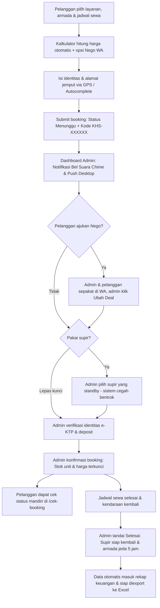

# Rencana Anggaran Biaya (RAB)
## Pengembangan Website & Sistem Reservasi Terintegrasi
### Klien: PT Khalisa Sumber Rezeki
### Domain Resmi: [khalisarental.id](https://www.khalisarental.id)

---

**Nomor Dokumen:** RAB/KSR/2026/10-01  
**Tanggal Penyusunan:** 31 Oktober 2026  
**Jenis Layanan:** Jasa Pengembangan Sistem Web Aplikasi Rental Mobil, Dashboard Operasional, dan Optimasi Digital  
**Total Nilai Investasi:** **Rp3.500.000** *(Tiga Juta Lima Ratus Ribu Rupiah)*  
**Sifat Pembayaran:** Sekali bayar *(one-time investment)* — Bebas biaya sewa server bulanan (Rp0/bulan)

---

## 1. Ringkasan Eksekutif & Nilai Investasi

Dokumen ini memuat rincian paket investasi pengembangan website resmi dan sistem operasional digital untuk **PT Khalisa Sumber Rezeki**. Sistem ini bukan sekadar website profil statis/brosur biasa, melainkan sebuah **Web Application (Sistem Reservasi & Operasional Mandiri)** yang dibangun khusus dari nol (*from scratch*) tanpa template beli jadi.

### Keuntungan Utama untuk PT Khalisa Sumber Rezeki:
1. **Otomatisasi Operasional**: Pelanggan dapat menghitung estimasi sewa, mengecek ketersediaan unit, memilih lepas kunci/supir, dan melakukan booking secara mandiri 24 jam.
2. **Dashboard Manajemen Terintegrasi**: Mengelola armada, mengatur penugasan supir anti-bentrok jadwal, mengunci harga hasil negosiasi (*Ubah Deal*), dan mengunduh laporan Excel rapi.
3. **Efisiensi Biaya Server (Rp0/Bulan)**: Menggunakan arsitektur modern berbasis *Cloud Serverless* (Vercel & Supabase Cloud) sehingga perusahaan **bebas biaya langganan hosting bulanan seumur hidup**.
4. **Cepat Balik Modal (*High ROI*)**: Dengan rata-rata tarif rental sewa mobil di angka Rp850.000 – Rp2.500.000/hari, investasi Rp3.500.000 ini diperkirakan **tertutup penuh hanya dari 2 sampai 3 transaksi pemesanan pertama**.
5. **Visibilitas Mesin Pencari**: Telah dioptimasi dengan standar **Google AI Overview (Gemini)**, Google Maps resmi, dan meta thumbnail sehingga langsung bersaing dengan platform rental besar.

---

## 2. Rincian Anggaran Biaya per Modul Sistem (Rp3.500.000)

Rincian alokasi pekerjaan teknis disusun berdasarkan **52 jam kerja efektif** dengan rincian per modul sebagai berikut:

| No. | Modul & Lingkup Pekerjaan | Jam Kerja | Tarif Dasar / Jam | Subtotal |
|:---:|---|:---:|:---:|---:|
| **1** | **Analisis Kebutuhan & Struktur Alur Bisnis Rental** • Analisis sistem sewa jam, hari, dan bulan (minimal 12 jam) • Pemetaan alur supir, armada ready/booking, dan skema database | 4 jam | Rp65.000 | **Rp260.000** |
| **2** | **Desain UI/UX Antarmuka Modern & Responsif** • Desain kustom elegan ramah pengguna (ponsel, tablet, desktop) • Standarisasi ikon vektor modern Lucide (bebas emoji kartun) | 5 jam | Rp70.000 | **Rp350.000** |
| **3** | **Katalog Armada Cerdas & Multi-Varian** • Pengelompokan varian transmisi (Matic/Manual) & mesin (Bensin/Hybrid/EV) • Badge dinamis (Promo, Terlaris, Unit Baru), coret harga diskon • Tombol cepat konsultasi negosiasi WhatsApp ("Nego via WA") | 8 jam | Rp65.000 | **Rp520.000** |
| **4** | **Formulir Booking Cerdas & Mesin Geolokasi** • Kalkulator sewa proporsional fleksibel & toggle include paket tol • Autocomplete alamat Jakarta & sekitarnya via Geoapify API • Deteksi titik koordinat perangkat via GPS browser otomatis • Validasi nomor telepon internasional E.164 & kode booking unik (`KHS-XXXXXX`) | 8 jam | Rp65.000 | **Rp520.000** |
| **5** | **Dashboard Operasional Administrator (`/admin`)** • CRUD Armada & upload foto mobil ke Cloud Storage • Filter jadwal interaktif (Semua, Hari ini, Besok, 7 hari, Per Bulan, Custom Tanggal) • Fitur **"Ubah Deal"** harga hasil negosiasi yang mengunci saat dikonfirmasi • Ekspor rekap data booking ke file Excel rapi (`.xlsx`) berformat akuntansi | 11 jam | Rp65.000 | **Rp715.000** |
| **6** | **Sistem Notifikasi Real-time & Bel Suara (Audio Chime)** • Bel audio sintetis (*Web Audio API chime*) saat pesanan baru masuk • Web Push Notification desktop otomatis tanpa perlu reload layar • Notifikasi pengingat jadwal sewa pelanggan yang telah selesai | 4 jam | Rp70.000 | **Rp280.000** |
| **7** | **Backend Supabase PostgreSQL & Manajemen Supir** • Database relasional PostgreSQL dengan proteksi *Row Level Security (RLS)* • Validasi jadwal supir anti-bentrok (otomatis menolak supir yang bertugas) • Tombol **"Kirim ke Supir"** otomatis via WhatsApp terformat rapi + Maps • Otomatisasi jeda pembersihan/persiapan armada 5 jam pasca sewa | 7 jam | Rp65.000 | **Rp455.000** |
| **8** | **Deployment Vercel, Optimasi SEO AI Overview & Legal** • Konfigurasi domain produksi `khalisarental.id` & header keamanan HTTP • Optimasi SEO Google AI Overview, Schema.org `AutoRental` & rating 5.0 • Integrasi titik resmi Google Maps PT. Khalisa Sumber Rezeki • Penyusunan halaman **Syarat, Ketentuan & Privasi 10 Pasal Resmi** | 5 jam | Rp80.000 | **Rp400.000** |
| | **TOTAL BIAYA JASA IMPLEMENTASI SISTEM** | **52 Jam** | | **Rp3.500.000** |

---

## 3. Bonus Layanan & Nilai Tambah (Sudah Termasuk)

Dalam paket investasi Rp3.500.000 ini, pihak pengembang memberikan layanan nilai tambah tanpa biaya tambahan:

1. **Paket Pendampingan Operasional Awal (1 Bulan Pertama)**:
   * Pendampingan langsung selama bulan pertama jika staf admin mengalami kendala operasional atau pertanyaan teknis.
2. **Pelatihan Staf Admin**:
   * Sesi panduan penggunaan dashboard, pengubahan status booking, penugasan supir, dan penyesuaian harga promo.
3. **Buku Panduan Operasional Resmi (SOP Admin)**:
   * Disertakan dokumen panduan lengkap 10 bab (`PANDUAN_ADMIN.md`) yang siap dijadikan SOP internal perusahaan.
4. **Garansi Bebas Bug (*Bug-Free Warranty*)**:
   * Jaminan perbaikan gratis selama **30 hari kalender** sejak sistem diserahterimakan untuk setiap kendala sistem atau ketidaksesuaian fungsi.

---

## 4. Pemisahan Biaya Infrastruktur & Kepemilikan Sistem

| Komponen Infrastruktur | Biaya | Status Pembayaran | Keterangan |
|---|:---:|:---:|---|
| **Jasa Pembuatan Sistem Web** | **Rp3.500.000** | Ditagihkan | Sekali bayar *(one-time fee)*. |
| **Domain Kustom `khalisarental.id`** | Rp1.100.000 | Sudah Lunas | Dibayar pemilik langsung ke registrar untuk **masa aktif 5 tahun penuh (s/d 2031)**. |
| **Hosting Frontend (Vercel)** | **Rp0 / bulan** | Gratis | Serverless hosting tier Hobby (mampu melayani puluhan ribu pengunjung/bulan). |
| **Database & Storage (Supabase)** | **Rp0 / bulan** | Gratis | Kuota database PostgreSQL 500 MB dan file storage 1 GB gratis mencukupi operasional. |
| **Sertifikat SSL (HTTPS)** | **Rp0** | Gratis | Terpasang otomatis dan diperpanjang otomatis seumur hidup demi keamanan transaksi. |
| **Pencarian Alamat (Geoapify)** | **Rp0** | Gratis | Kuota 3.000 pencarian alamat per hari (sangat memadai untuk operasional harian). |

> [!NOTE]
> Seluruh kode sumber (*source code*), database, dan akses administratif menjadi **hak milik penuh PT Khalisa Sumber Rezeki** tanpa ada keterikatan royalti bulanan kepada pihak pengembang.

---

## 5. Alur Booking & Operasional Sistem

Berikut alur kerja pemesanan dari pelanggan hingga selesai di dashboard:

---

## 6. Syarat & Skema Pembayaran

Pembayaran jasa implementasi sistem dilakukan melalui 2 (dua) termin pembayaran:

* **Termin 1 (Uang Muka / DP 50%)**:  
  **Rp1.750.000** — Dibayarkan saat persetujuan dokumen RAB dan dimulainya finalisasi sistem.
* **Termin 2 (Pelunasan 50%)**:  
  **Rp1.750.000** — Dibayarkan setelah serah terima sistem, serah terima akses akun utama administrator, dan penyerahan dokumentasi panduan operasional.

---

## 7. Lembar Pengesahan & Persetujuan

Dokumen Rencana Anggaran Biaya ini berlaku sebagai acuan kerja resmi yang mengikat kedua belah pihak:

 

| Disetujui Oleh, | Diajukan Oleh, |
|:---:|:---:|
| **PT Khalisa Sumber Rezeki** | **Pengembang Sistem Web** |
|    *( .................................................... )* Pimpinan / Manajemen |    *( .................................................... )* Developer & Sistem Implementator |
| **Tanggal:** ........................................ | **Tanggal:** 31 Oktober 2026 |
