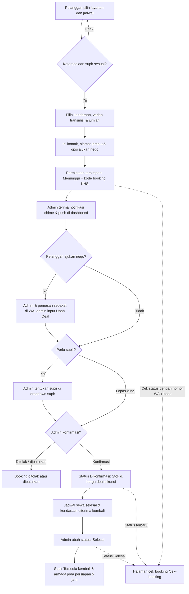

# Rencana Anggaran Biaya (RAB)
## Website Rental Mobil PT Khalisa Sumber Rezeki
### Skema Penawaran Khusus: Rp3.000.000 – Rp3.500.000

**Tanggal penyusunan:** 2 Oktober 2026  
**Tanggal pembaruan & penyesuaian:** 30 Oktober 2026  
**Jenis anggaran:** Penawaran paket investasi implementasi website, sistem operasional, dan pendampingan bisnis  
**Status domain:** Domain kustom `khalisarental.id` aktif untuk periode 5 tahun (Rp1.100.000 / 5 tahun dibayar terpisah oleh pemilik)  
**Status hosting & database:** Bebas biaya bulanan (Rp0 / bulan menggunakan arsitektur serverless Vercel & Supabase Cloud)

---

## 1. Ringkasan Skema Penawaran (Rp3.000.000 vs Rp3.500.000)

Tersedia 2 (dua) opsi paket yang dirancang khusus untuk mendukung operasional rental mobil PT Khalisa Sumber Rezeki secara optimal:

| Komponen Fitur & Layanan | Opsi A: Paket Pro (Rp3.000.000) | Opsi B: Paket Pro Max + Pendampingan ⭐ (Rp3.500.000) |
|---|:---:|:---:|
| **Nilai Jasa Sistem** | **Rp3.000.000** *(Sekali bayar)* | **Rp3.500.000** *(Sekali bayar)* |
| **Katalog Armada Cerdas & Multi Varian** | Termasuk | Termasuk |
| **Varian Transmisi (Matic/Manual) & Mesin (Bensin/Hybrid/EV)** | Termasuk | Termasuk |
| **Formulir Booking Cerdas (Jam/Hari/Bulan, Tol, GPS)** | Termasuk | Termasuk |
| **Fitur Negosiasi Harga ("Bisa Nego" & Quick Chat WA)** | Termasuk | Termasuk |
| **Fitur "Ubah Deal" Harga Nego di Admin** | Termasuk | Termasuk |
| **Dashboard Operasional Admin & Supir** | Termasuk | Termasuk |
| **Notifikasi Bel Audio Chime & Push Desktop** | Termasuk | Termasuk |
| **Rekap Keuangan Jakarta Time & Export Excel (.xlsx)** | Termasuk | Termasuk |
| **Halaman Cek Status Booking Mandiri (`/cek-booking`)** | Termasuk | Termasuk |
| **Proteksi Keamanan Database (RLS & Anti-Brute Force)** | Termasuk | Termasuk |
| **Garansi Bug Teknis Pasca Rilis** | 30 Hari Kalender | 30 Hari Kalender |
| **Paket Pendampingan Operasional Awal** | Panduan standar | **Termasuk Penuh (1 Bulan Pertama)** |
| **Pelatihan & Training Intensif Staf Admin** | Panduan PDF/Teks | **Sesi Pelatihan Langsung / Remote** |
| **Bantuan Teknis Input Armada & Penyesuaian Harga** | Mandiri via dashboard | **Didampingi & Dibantu Teknis (1 Bulan)** |
| **Biaya Domain Kustom (Aktif 5 Tahun Penuh)** | Rp1.100.000 | Rp1.100.000 |
| **Biaya Hosting & Server Bulanan** | **Rp0 (Gratis)** | **Rp0 (Gratis)** |
| **TOTAL INVESTASI (5 TAHUN BERJALAN)** | **Rp4.100.000** | **Rp4.600.000** |
| **Beban Biaya per Tahun** | **~Rp820.000 / tahun** | **~Rp920.000 / tahun** |
| **Beban Biaya per Bulan** | **~Rp68.000 / bulan** | **~Rp76.000 / bulan** |

---

## 2. Rincian Pekerjaan Teknis — Opsi A: Paket Pro (Rp3.000.000)

Total waktu pengerjaan: **52 jam kerja** (rata-rata tarif dasar Rp57.600 / jam):

| No. | Uraian pekerjaan teknis | Estimasi waktu | Tarif dasar | Jumlah |
|---:|---|---:|---:|---:|
| 1 | Analisis alur bisnis rental, relasi supir-jadwal, dan struktur data booking | 4 jam | Rp55.000 | Rp220.000 |
| 2 | Desain antarmuka UI/UX modern, responsif ponsel/desktop, dan micro-interactions | 5 jam | Rp65.000 | Rp325.000 |
| 3 | Katalog armada cerdas, pengelompokan varian, badge "Bisa Nego", dan konsultasi WA | 9 jam | Rp60.000 | Rp540.000 |
| 4 | Formulir booking cerdas, validasi E.164, durasi fleksibel min. 12 jam, tol, GPS, dan checkbox nego WA | 8 jam | Rp60.000 | Rp480.000 |
| 5 | Dashboard admin terintegrasi: CRUD armada/foto cloud, modal detail, fitur **"Ubah Deal"** harga nego terkunci, dan ekspor Excel | 11 jam | Rp60.000 | Rp660.000 |
| 6 | **Sistem Notifikasi Real-time:** Bel audio sintetis (Web Audio API chime) & Web Push Notification desktop | 4 jam | Rp65.000 | Rp260.000 |
| 7 | Integrasi Supabase, manajemen supir anti-bentrok jadwal, direct fallback, dan proteksi RLS | 6 jam | Rp55.000 | Rp330.000 |
| 8 | Pengujian sistem, penguatan keamanan, persistensi sesi reload, SEO Google, dan serah terima | 5 jam | Rp37.000 | Rp185.000 |
|  | **Total Jasa Opsi A (52 jam)** |  |  | **Rp3.000.000** |

---

## 3. Rincian Pekerjaan Teknis — Opsi B: Paket Pro Max + Pendampingan (Rp3.500.000)

Mencakup seluruh modul sistem Opsi A ditambah **Paket Layanan Pendampingan Operasional Awal selama 1 Bulan Penuh**:

| No. | Komponen Pekerjaan & Layanan | Keterangan & Benefit | Nilai Alokasi |
|---:|---|---|---:|
| 1 | **Pengembangan Sistem Rental Lengkap (Sesuai Opsi A)** | Seluruh modul website, booking cerdas, dashboard admin, notifikasi real-time, manajemen supir, dan integrasi cloud | Rp3.000.000 |
| 2 | **Paket Pendampingan Operasional & Maintenance (1 Bulan)** | Pendampingan teknis prioritas di bulan pertama operasional: monitoring kestabilan sistem, pemantauan error logs, dan backup database | Rp300.000 |
| 3 | **Pelatihan Staf Admin & Bantuan Konten Armada** | Sesi pelatihan langsung untuk pengelola admin, pendampingan input data armada baru, penyesuaian promo, dan optimasi foto | Rp200.000 |
|  | **Total Jasa Opsi B (Pro Max + Pendampingan)** |  | **Rp3.500.000** |

---

## 4. Alur Kerja Sistem (Mermaid Flowchart)

---

## 5. Kepemilikan & Biaya Operasional Jangka Panjang

| Komponen | Biaya | Status & Keterangan |
|---|---:|---|
| **Jasa Pembuatan Sistem (Opsi A / Opsi B)** | Rp3.000.000 / Rp3.500.000 | Sekali bayar *(one-time fee)* sesuai paket yang dipilih. |
| **Domain Kustom `khalisarental.id` (5 Tahun)** | Rp1.100.000 | Telah dibeli langsung oleh pemilik ke registrar; **aktif aman hingga 2031**. |
| **Hosting Frontend (Vercel Serverless)** | **Rp0 / bulan (Gratis)** | Menggunakan paket standar cloud yang mampu menangani puluhan ribu pengunjung/bulan. |
| **Database & File Storage (Supabase Cloud)** | **Rp0 / bulan (Gratis)** | Penyimpanan data pelanggan, transaksi, dan foto armada di cloud tanpa tagihan bulanan. |
| **Sertifikat Keamanan SSL (HTTPS)** | **Rp0 (Gratis)** | Gembok hijau keamanan web terpasang otomatis seumur hidup. |
| **Pajak** | Belum dihitung | Ditambahkan bila berlaku sesuai ketentuan perpajakan. |

---

## 6. Kesimpulan & Rekomendasi

Kedua opsi penawaran ini memberikan nilai investasi yang sangat kompetitif untuk PT Khalisa Sumber Rezeki:
1. **Opsi A (Rp3.000.000):** Sangat cocok jika pemilik rental ingin solusi hemat dengan sistem yang sudah 100% lengkap (termasuk fitur nego deal dan notifikasi suara).
2. **Opsi B (Rp3.500.000):** Pilihan paling direkomendasikan karena hanya dengan selisih Rp500.000, pemilik rental mendapatkan **jaminan pendampingan operasional selama 1 bulan penuh** serta pelatihan staf admin sampai benar-benar mahir menggunakan dashboard.
