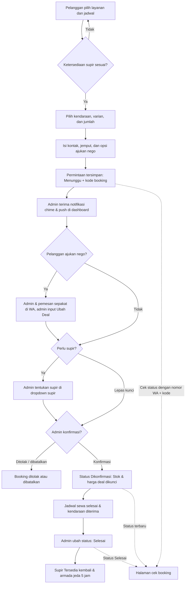

# Rencana Anggaran Biaya (RAB)
## Website Rental Mobil PT Khalisa Sumber Rezeki

**Tanggal penyusunan:** 2 Oktober 2026  
**Tanggal pembaruan & penyesuaian:** 30 Oktober 2026  
**Jenis anggaran:** Penawaran paket investasi implementasi sistem dan operasional website  
**Status domain:** Domain kustom `khalisarental.id` aktif untuk periode 5 tahun (Rp1.100.000 / 5 tahun dibayar terpisah oleh pemilik)  
**Status hosting & database:** Bebas biaya bulanan (Rp0 / bulan menggunakan arsitektur serverless Vercel & Supabase Cloud)

---

## Ringkasan Skema Penawaran

Tersedia 2 (dua) opsi skema penawaran investasi yang disesuaikan dengan kebutuhan operasional PT Khalisa Sumber Rezeki:

| Komponen Penawaran | Opsi 1: Paket Pro + Fitur Nego & Notifikasi ⭐ *(Rekomendasi)* | Opsi 2: Paket Enterprise + Maintenance 3 Bulan |
|---|:---:|:---:|
| **Biaya Jasa Sistem** | **Rp3.500.000** *(Sekali bayar)* | **Rp5.000.000** *(Sekali bayar)* |
| **Katalog Armada & "Bisa Nego"** | Termasuk | Termasuk |
| **Formulir Booking Cerdas & GPS** | Termasuk | Termasuk |
| **Dashboard Admin & Ubah Deal Nego** | Termasuk | Termasuk |
| **Notifikasi Audio Chime & Web Push** | Termasuk | Termasuk |
| **Manajemen Supir & Validasi Jadwal** | Termasuk | Termasuk |
| **Laporan Keuangan & Export Excel** | Termasuk | Termasuk |
| **Keamanan Database (RLS & Anti-Brute Force)**| Termasuk | Termasuk |
| **Garansi Bug Pasca Serah Terima** | 30 Hari Kalender | 30 Hari Kalender |
| **Paket Pendampingan & Maintenance Rutin** | Tambahan opsional | **Termasuk Penuh (3 Bulan)** |
| **Bantuan Input & Update Data Armada Baru** | Mandiri via Dashboard | Dibantu teknis selama 3 bulan |
| **Biaya Domain Kustom (Aktif 5 Tahun)** | Rp1.100.000 | Rp1.100.000 |
| **Biaya Sewa Server / Hosting Bulanan** | **Rp0 (Gratis)** | **Rp0 (Gratis)** |
| **TOTAL INVESTASI BERSIH (5 TAHUN)** | **Rp4.600.000** | **Rp6.100.000** |
| **Rata-rata Biaya / Tahun** | **~Rp920.000 / tahun** | **~Rp1.220.000 / tahun** |
| **Rata-rata Biaya / Bulan** | **~Rp76.000 / bulan** | **~Rp101.000 / bulan** |

---

## Rincian Perhitungan Jam Kerja — Opsi 1 (Rp3.500.000)

Rincian alokasi pekerjaan teknis untuk **Opsi 1 (Rp3.500.000)** dengan total estimasi waktu **54 jam kerja** (rata-rata tarif Rp64.800 / jam):

| No. | Uraian pekerjaan teknis | Estimasi waktu | Tarif dasar | Jumlah |
|---:|---|---:|---:|---:|
| 1 | Analisis kebutuhan bisnis, alur sewa jam/hari/bulan, dan struktur data | 4 jam | Rp65.000 | Rp260.000 |
| 2 | Desain UI/UX modern, responsif (mobile & desktop), dan micro-interactions | 5 jam | Rp70.000 | Rp350.000 |
| 3 | Katalog armada cerdas, pengelompokan varian model, badge Promo/Terlaris, fitur "Bisa Nego", dan quick WhatsApp link | 8 jam | Rp65.000 | Rp520.000 |
| 4 | Formulir booking cerdas, validasi E.164, durasi fleksibel minimum 12 jam, tol otomatis, GPS/Geoapify, dan opsi ajukan nego via WA | 8 jam | Rp65.000 | Rp520.000 |
| 5 | Dashboard operasional `/admin`: CRUD armada/foto cloud, rekap keuangan Jakarta time, filter jadwal interaktif, modal detail, fitur "Ubah Deal" harga nego, dan ekspor Excel rapi | 12 jam | Rp65.000 | Rp780.000 |
| 6 | Sistem Notifikasi Real-time: Bel audio sintetis (Web Audio API chime) dan Web Push Notification desktop untuk booking baru & jadwal selesai | 4 jam | Rp70.000 | Rp280.000 |
| 7 | Integrasi Supabase PostgreSQL, manajemen supir anti-bentrok, direct update fallback, dan proteksi Row Level Security (RLS) | 7 jam | Rp65.000 | Rp455.000 |
| 8 | Pengujian sistem, penguatan keamanan (anti brute-force login), konfigurasi domain `khalisarental.id`, SEO Google, dan serah terima | 6 jam | Rp55.800 | Rp335.000 |
|  | **Total Jasa Opsi 1 (54 jam)** |  |  | **Rp3.500.000** |

---

## Rincian Perhitungan — Opsi 2 (Rp5.000.000)

Untuk **Opsi 2 (Rp5.000.000)**, mencakup seluruh pekerjaan sistem di atas ditambah **Paket Layanan Prioritas & Pendampingan Operasional selama 3 Bulan**:

| No. | Komponen Pekerjaan & Layanan | Keterangan & Benefit | Nilai Alokasi |
|---:|---|---|---:|
| 1 | **Pengembangan Sistem Rental Lengkap (Sesuai Opsi 1)** | Seluruh modul publik, booking cerdas, dashboard admin, notifikasi real-time, supir, dan integrasi cloud | Rp3.500.000 |
| 2 | **Paket Pendampingan Teknis & Maintenance (3 Bulan)** | Bantuan teknis prioritas selama 3 bulan pertama operasional: monitoring performa sistem, pemantauan error logs, dan backup data berkala | Rp900.000 |
| 3 | **Bantuan Pengelolaan & Konten Armada** | Pendampingan input, update harga/promo, optimasi foto armada baru, dan pelatihan staf admin secara intensif | Rp600.000 |
|  | **Total Jasa Opsi 2 (Full Enterprise + Pendampingan)** |  | **Rp5.000.000** |

---

## Pemisahan Total Biaya & Kepemilikan Infrastruktur

| Komponen | Biaya | Status & Keterangan |
|---|---:|---|
| **Jasa Pembuatan Sistem (Opsi 1 atau Opsi 2)** | Rp3.500.000 / Rp5.000.000 | Sekali bayar *(one-time investment)* sesuai opsi yang dipilih. |
| **Domain Kustom `khalisarental.id` (5 Tahun Penuh)** | Rp1.100.000 | Telah dibayar langsung oleh pemilik ke registrar; **bebas tagihan tahunan hingga 2031**. |
| **Hosting Frontend (Vercel Serverless)** | **Rp0 / bulan (Gratis)** | Menggunakan paket Hobby tier yang mampu melayani puluhan ribu pengunjung/bulan. |
| **Database & File Storage (Supabase Cloud)** | **Rp0 / bulan (Gratis)** | Kuota database 500 MB dan storage foto 1 GB gratis mencukupi untuk operasional harian. |
| **Sertifikat Keamanan SSL (HTTPS)** | **Rp0 (Gratis)** | Terpasang otomatis dan diperbarui otomatis seumur hidup. |
| **Pajak** | Belum dihitung | Ditambahkan bila berlaku sesuai ketentuan perpajakan. |

---

## Rincian Lingkup Pekerjaan

### 1. Analisis kebutuhan dan alur bisnis — Rp200.000
- **Aktivitas:** Inventarisasi halaman dan peran pengguna (2 jam × Rp50.000 = Rp100.000); pemetaan proses booking serta keputusan admin (1 jam × Rp50.000 = Rp50.000); penetapan daftar kebutuhan dan batas pekerjaan (1 jam × Rp50.000 = Rp50.000).
- **Hasil:** Daftar halaman, kebutuhan pelanggan/admin, urutan status booking, dan batas fitur yang masuk ke estimasi.

### 2. Desain UI/UX dan penyesuaian responsif — Rp300.000
- **Aktivitas:** Struktur halaman dan hierarki informasi (2 jam × Rp60.000 = Rp120.000); penataan komponen publik dan admin (2 jam × Rp60.000 = Rp120.000); penyesuaian breakpoint desktop/ponsel (1 jam × Rp60.000 = Rp60.000).
- **Hasil:** Sistem tampilan responsif yang diterapkan pada halaman publik, form booking, dan dashboard operasional.

### 3. Halaman publik, katalog, dan detail kendaraan — Rp450.000
- **Aktivitas:** Beranda, navigasi, dan bagian informasi usaha (2 jam × Rp50.000 = Rp100.000); katalog, filter kategori, dan pengelompokan model (2 jam × Rp50.000 = Rp100.000); kartu/detail kendaraan beserta varian, stok, harga acuan, badge "Bisa Nego", dan konsultasi harga via WhatsApp (3 jam × Rp50.000 = Rp150.000); halaman syarat dan ketentuan serta cek booking (2 jam × Rp50.000 = Rp100.000).
- **Rincian hasil:** Pengunjung dapat mencari model melalui kategori; melihat foto, spesifikasi, harga, ketersediaan dan varian transmisi/mesin pada kartu atau detail kendaraan; opsi cepat "💬 Nego via WA" untuk negosiasi langsung ke admin; membaca syarat sewa; serta membuka halaman cek booking.

### 4. Formulir booking dan alur WhatsApp — Rp400.000
- **Aktivitas dan estimasi:**
  - Pilihan layanan (Dengan Supir, Lepas Kunci, Paket Acara), tanggal, jam, durasi bulan/hari/jam, dan batas minimum 12 jam (2 jam × Rp50.000 = **Rp100.000**).
  - Pemilihan model, varian, transmisi, kuantitas, opsi include tol, kalkulasi harga proporsional, dan opsi checkbox "Saya ingin ajukan nego harga via WhatsApp" (2 jam × Rp50.000 = **Rp100.000**).
  - Validasi nama dan format nomor telepon internasional E.164, autocomplete alamat via Geoapify, dan opsi pengambilan lokasi perangkat (2 jam × Rp50.000 = **Rp100.000**).
  - Penyimpanan data booking ke Supabase, sinkronisasi mode sewa dengan batasan database, pembuatan kode booking unik (`KHS-XXXXXX`), dan penyusunan pesan WhatsApp serta tautan Google Maps (2 jam × Rp50.000 = **Rp100.000**).
- **Rincian durasi dan harga:** Satu bulan dihitung tetap 30 hari; satu hari 24 jam. Durasi minimum 12 jam. Tarif dasar dihitung proporsional `tarif dasar × (total jam ÷ 12)`.
- **Rincian lokasi:** Pelanggan dapat mencari alamat di Jakarta dan sekitarnya menggunakan Geoapify, memilih hasil untuk menyimpan teks alamat dan koordinat, atau mendeteksi lokasi perangkat via GPS.

### 5. Dashboard admin dan pengelolaan operasional — Rp500.000
- **Aktivitas:** Akses dashboard dan sesi admin persisten tanpa reset saat reload (2 jam × Rp50.000 = Rp100.000); pemrosesan booking, penugasan supir tervalidasi, ubah deal harga nego, dan modal detail booking (3 jam × Rp50.000 = Rp150.000); CRUD armada/foto dan manajemen tim supir (3 jam × Rp50.000 = Rp150.000); ringkasan keuangan Jakarta time, notifikasi Web Push & bel audio chime real-time, ekspor Excel dengan filter periode, dan manajemen akun admin (2 jam × Rp50.000 = Rp100.000).
- **Hasil:** Dashboard `/admin` terintegrasi, notifikasi suara dan push desktop otomatis saat pesanan masuk/selesai, fitur ubah harga deal nego terkunci, validasi kewajiban pilih supir sebelum konfirmasi status, ekspor data booking ke file `.xlsx` berformat rapi, statistik pemakaian jam-unit kendaraan, dan riwayat pesanan supir. Booking diselesaikan manual setelah kendaraan kembali dan diterima.

### 6. Integrasi Supabase dan kontrol akses — Rp300.000
- **Aktivitas:** Konfigurasi koneksi frontend dan environment (1 jam × Rp50.000 = Rp50.000); integrasi autentikasi/role admin berbasis server claims (1 jam × Rp50.000 = Rp50.000); alur baca/tulis katalog, booking, supir, dan cloud storage (2 jam × Rp50.000 = Rp100.000); integrasi RPC ketersediaan, konfirmasi otomatis supir, fallback direct update penugasan supir, dan realtime postgres changes (2 jam × Rp50.000 = Rp100.000).
- **Rincian hasil:** Frontend memakai Supabase URL dan anon key terisolasi; alur admin divalidasi ke server Supabase; ketersediaan supir dan armada diperiksa atomik; penugasan supir terlindung dari bentrok RPC; serta sinkronisasi realtime booking baru.

### 7. Pengujian, perbaikan bug, dan penguatan keamanan — Rp200.000
- **Aktivitas:** Build dan pemeriksaan kode (1 jam × Rp50.000 = Rp50.000); pengujian alur booking/admin dan perbaikan bug tipe database (2 jam × Rp50.000 = Rp100.000); penguatan keamanan web & anti-brute force (1 jam × Rp50.000 = Rp50.000).
- **Cakupan penguatan keamanan:** Penambalan dependensi berisiko (Vite & source-map); proteksi brute-force login admin otomatis (lockout 60 detik setelah 5 kali gagal); pengetatan izin database (RLS data pelanggan anonim); isolasi file foto di Cloud Storage; dan perbaikan format mata uang konsisten.

### 8. Deployment, optimasi SEO, dan serah terima — Rp150.000
- **Aktivitas:** Konfigurasi deployment Vercel dengan header keamanan HTTP lengkap (1 jam × Rp50.000 = Rp50.000); optimasi SEO teknis (`sitemap.xml`, `robots.txt`, dan Schema.org `AutoRental` JSON-LD) (1 jam × Rp50.000 = Rp50.000); serah terima source code, panduan admin, dan dokumentasi (1 jam × Rp50.000 = Rp50.000).
- **Hasil:** Source code bersih, header keamanan produksi aktif di Vercel, domain kustom `khalisarental.id` terkonfigurasi, metadata SEO ramah Google Search & Google Maps, panduan admin, dan garansi perbaikan bug 30 hari setelah serah terima.

---

## Alur Kerja Website

### Alur booking dari pelanggan sampai selesai

1. **Pelanggan memilih layanan dan jadwal:** Pelanggan memilih tanggal, jam mulai, dan durasi dalam bulan, hari, jam, atau kombinasinya. Kapasitas supir diperiksa secara otomatis. Opsi **Butuh supir** hanya dapat dipilih jika ada supir yang siap pada jadwal tersebut.
2. **Pelanggan memilih kendaraan:** Katalog menampilkan kendaraan yang ready dengan opsi **Bisa Nego**. Pelanggan memilih varian transmisi/mesin dan jumlah unit; harga acuan dan subtotal dihitung otomatis.
3. **Pelanggan mengisi data dan mengirim permintaan:** Nama, nomor WhatsApp, lokasi penjemputan, dan opsi pengajuan negosiasi harga divalidasi. Permintaan tersimpan berstatus **Menunggu** dengan kode booking unik (`KHS-XXXXXX`). Tautan pesan WhatsApp dan Google Maps disiapkan.
4. **Admin menerima notifikasi:** Browser admin membunyikan bel audio chime dan menampilkan Web Push Notification bahwa pesanan baru telah masuk.
5. **Admin memeriksa dan negosiasi harga (jika ada):** Admin meninjau rincian di dashboard `/admin`. Jika pelanggan mengajukan nego dan tercapai kesepakatan lewat WhatsApp, admin menekan tombol **Ubah Deal** di modal booking untuk memperbarui nominal harga deal.
6. **Admin menugaskan supir:** Untuk pesanan dengan mode sewa supir, admin wajib memilih supir yang tersedia terlebih dahulu pada kolom supir.
7. **Admin mengonfirmasi booking:** Admin mengubah status menjadi **Dikonfirmasi**. Database mengunci stok unit dan nominal harga deal terkunci (tidak dapat diubah kembali).
8. **Admin menyelesaikan booking:** Setelah waktu sewa selesai (admin menerima pemberitahuan desktop/suara), kendaraan diterima kembali, dan admin menandai booking menjadi **Selesai**.
9. **Ketersediaan diperbarui:** Supir kembali berstatus Tersedia dan armada memiliki jeda persiapan **5 jam** sebelum dapat disewa kembali.

---

## Biaya Operasional di Luar Jasa

Biaya berikut **tidak termasuk** dalam total jasa Rp2.500.000:

| Komponen | Perkiraan perlakuan biaya | Catatan |
|---|---|---|
| Domain | Biaya tahunan, mengikuti registrar dan ekstensi domain | Biaya berulang per tahun (misal: `.com` atau `.co.id`). |
| Hosting frontend Vercel | Paket gratis (Hobby tier) | Sudah mencukupi untuk traffic website rental mobil standar. |
| Database & Storage Supabase | Paket gratis (Free tier) | Mencukupi untuk data armada, ribuan booking, dan foto kendaraan. |
| API Lokasi Geoapify | Paket gratis (3.000 request/hari) | Sangat mencukupi untuk kebutuhan pencarian alamat harian. |
| WhatsApp | Tautan langsung `wa.me` | Membuka WhatsApp secara instan tanpa biaya langganan API berbayar. |

---

## Tidak Termasuk

- Pembelian nama domain khusus dan langganan infrastruktur berbayar jika melewati kuota gratis provider.
- WhatsApp Business API berbayar, SMS gateway, atau email transaksional berbayar.
- Payment gateway online (pembayaran diverifikasi manual via transfer rekening/cash).
- Aplikasi mobile native Android/iOS terpisah di Play Store / App Store.
- Pembuatan konten fotografi armada profesional dan perancangan logo baru.
- Penambahan modul fitur baru di luar ruang lingkup yang disepakati setelah masa garansi 30 hari.

---

## Asumsi dan Ketentuan

- Pemilik menyediakan akses ke project Vercel, Supabase, domain, dan Geoapify. Kredensial rahasia (`service_role`) tidak pernah dimasukkan ke dalam kode publik.
- Database Supabase telah dilengkapi fungsi RPC penugasan supir, pencegahan overbooking, dan kebijakan keamanan data (RLS).
- Garansi perbaikan bug yang dapat direproduksi berlaku 30 hari kalender terhitung sejak serah terima.
