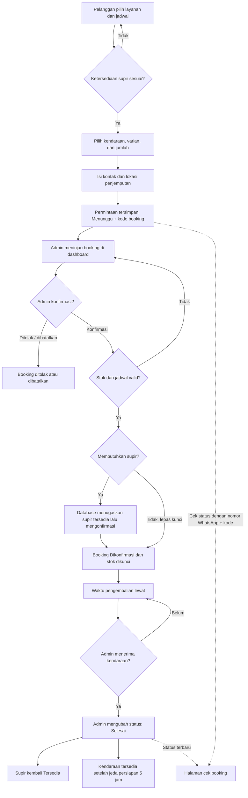

# Rencana Anggaran Biaya (RAB)
## Website Rental Mobil PT Khalisa Sumber Rezeki

**Tanggal penyusunan:** 2 Oktober 2026  
**Tanggal pembaruan & finalisasi:** 27 Oktober 2026  
**Jenis anggaran:** Estimasi jasa pembuatan, implementasi, dan penguatan website, satu kali (one-time)  
**Nilai jasa:** **Rp2.500.000**  
**Status domain khusus:** Tidak termasuk

> Dokumen ini adalah rincian penawaran dan serah terima jasa berdasarkan ruang lingkup fitur website yang tercantum, bukan bukti biaya historis atau invoice pembayaran. Total Rp2.500.000 dialokasikan penuh untuk pekerjaan jasa teknis; biaya pembelian domain dan tagihan provider dibayar terpisah.

---

## Ringkasan Anggaran

| No. | Uraian pekerjaan | Estimasi waktu | Tarif dasar | Jumlah |
|---:|---|---:|---:|---:|
| 1 | Analisis kebutuhan dan alur bisnis | 4 jam | Rp50.000 | Rp200.000 |
| 2 | Desain UI/UX dan penyesuaian responsif | 5 jam | Rp60.000 | Rp300.000 |
| 3 | Halaman publik, katalog, dan detail kendaraan | 9 jam | Rp50.000 | Rp450.000 |
| 4 | Formulir booking, validasi, perhitungan, dan alur WhatsApp | 8 jam | Rp50.000 | Rp400.000 |
| 5 | Dashboard admin dan pengelolaan operasional | 10 jam | Rp50.000 | Rp500.000 |
| 6 | Integrasi Supabase dan kontrol akses aplikasi | 6 jam | Rp50.000 | Rp300.000 |
| 7 | Pengujian, perbaikan bug, dan penguatan keamanan | 4 jam | Rp50.000 | Rp200.000 |
| 8 | Konfigurasi deployment, optimasi SEO, dan serah terima | 3 jam | Rp50.000 | Rp150.000 |
|  | **Total estimasi jasa (49 jam)** |  |  | **Rp2.500.000** |

Rata-rata nilai jasa pada estimasi ini sekitar **Rp51.000 per jam**. Jam kerja merupakan dasar penyusunan anggaran, bukan pencatatan timesheet aktual.

### Pemisahan total biaya

| Komponen | Biaya dalam RAB | Keterangan |
|---|---:|---|
| Jasa analisis, desain, pembuatan, integrasi, pengujian, keamanan, dan serah terima | Rp2.500.000 | Biaya satu kali sesuai rincian di atas. |
| Domain khusus, misalnya `khalisarentcar.com` atau `khalisarentcar.co.id` | Tidak termasuk | Pemilik membeli langsung melalui registrar (Niagahoster, Domainesia, dsb). |
| Vercel, Supabase, dan Geoapify | Tidak ditagihkan dalam RAB ini | Menggunakan paket gratis/kuota standar yang mencukupi untuk operasional. Biaya peningkatan kuota, jika ada, dibayar langsung ke provider. |
| Pajak | Belum dihitung | Ditambahkan bila berlaku sesuai status penyedia jasa dan ketentuan perpajakan. |
| **Jumlah jasa yang ditawarkan** | **Rp2.500.000** | **Belum termasuk domain, tagihan provider, dan pajak yang mungkin berlaku.** |

---

## Rincian Lingkup Pekerjaan

### 1. Analisis kebutuhan dan alur bisnis — Rp200.000
- **Aktivitas:** Inventarisasi halaman dan peran pengguna (2 jam × Rp50.000 = Rp100.000); pemetaan proses booking serta keputusan admin (1 jam × Rp50.000 = Rp50.000); penetapan daftar kebutuhan dan batas pekerjaan (1 jam × Rp50.000 = Rp50.000).
- **Hasil:** Daftar halaman, kebutuhan pelanggan/admin, urutan status booking, dan batas fitur yang masuk ke estimasi.

### 2. Desain UI/UX dan penyesuaian responsif — Rp300.000
- **Aktivitas:** Struktur halaman dan hierarki informasi (2 jam × Rp60.000 = Rp120.000); penataan komponen publik dan admin (2 jam × Rp60.000 = Rp120.000); penyesuaian breakpoint desktop/ponsel (1 jam × Rp60.000 = Rp60.000).
- **Hasil:** Sistem tampilan responsif yang diterapkan pada halaman publik, form booking, dan dashboard operasional.

### 3. Halaman publik, katalog, dan detail kendaraan — Rp450.000
- **Aktivitas:** Beranda, navigasi, dan bagian informasi usaha (2 jam × Rp50.000 = Rp100.000); katalog, filter kategori, dan pengelompokan model (2 jam × Rp50.000 = Rp100.000); kartu/detail kendaraan beserta varian, stok, dan harga (3 jam × Rp50.000 = Rp150.000); halaman syarat dan ketentuan serta cek booking (2 jam × Rp50.000 = Rp100.000).
- **Rincian hasil:** Pengunjung dapat mencari model melalui kategori; melihat foto, spesifikasi, harga, ketersediaan dan varian transmisi/mesin pada kartu atau detail kendaraan; membaca syarat sewa; serta membuka halaman cek booking.

### 4. Formulir booking dan alur WhatsApp — Rp400.000
- **Aktivitas dan estimasi:**
  - Pilihan layanan (Dengan Supir, Lepas Kunci, Paket Acara), tanggal, jam, durasi bulan/hari/jam, dan batas minimum 12 jam (2 jam × Rp50.000 = **Rp100.000**).
  - Pemilihan model, varian, transmisi, kuantitas, opsi include tol, dan kalkulasi harga proporsional (2 jam × Rp50.000 = **Rp100.000**).
  - Validasi nama dan format nomor telepon internasional E.164, autocomplete alamat via Geoapify, dan opsi pengambilan lokasi perangkat (2 jam × Rp50.000 = **Rp100.000**).
  - Penyimpanan data booking ke Supabase, sinkronisasi mode sewa dengan batasan database, pembuatan kode booking unik (`KHS-XXXXXX`), dan penyusunan pesan WhatsApp serta tautan Google Maps (2 jam × Rp50.000 = **Rp100.000**).
- **Rincian durasi dan harga:** Satu bulan dihitung tetap 30 hari; satu hari 24 jam. Durasi minimum 12 jam. Tarif dasar dihitung proporsional `tarif dasar × (total jam ÷ 12)`.
- **Rincian lokasi:** Pelanggan dapat mencari alamat di Jakarta dan sekitarnya menggunakan Geoapify, memilih hasil untuk menyimpan teks alamat dan koordinat, atau mendeteksi lokasi perangkat via GPS.

### 5. Dashboard admin dan pengelolaan operasional — Rp500.000
- **Aktivitas:** Akses dashboard dan sesi admin (2 jam × Rp50.000 = Rp100.000); pemrosesan booking, penugasan supir, dan modal detail booking (3 jam × Rp50.000 = Rp150.000); CRUD armada/foto dan manajemen tim supir (3 jam × Rp50.000 = Rp150.000); ringkasan keuangan Jakarta time, grafik tren, ekspor Excel dengan filter periode, dan manajemen akun admin (2 jam × Rp50.000 = Rp100.000).
- **Hasil:** Dashboard `/admin` terintegrasi, modal detail interaktif, ekspor data booking ke file `.xlsx` berformat rapi, statistik pemakaian jam-unit kendaraan, dan riwayat pesanan supir. Booking diselesaikan manual setelah kendaraan kembali dan diterima.

### 6. Integrasi Supabase dan kontrol akses — Rp300.000
- **Aktivitas:** Konfigurasi koneksi frontend dan environment (1 jam × Rp50.000 = Rp50.000); integrasi autentikasi/role admin berbasis server claims (1 jam × Rp50.000 = Rp50.000); alur baca/tulis katalog, booking, supir, dan cloud storage (2 jam × Rp50.000 = Rp100.000); integrasi RPC ketersediaan, konfirmasi otomatis supir, dan overload penugasan supir (2 jam × Rp50.000 = Rp100.000).
- **Rincian hasil:** Frontend memakai Supabase URL dan anon key terisolasi; alur admin divalidasi ke server Supabase; ketersediaan supir dan armada diperiksa atomik; serta penugasan supir UUID terproteksi via RPC database.

### 7. Pengujian, perbaikan bug, dan penguatan keamanan — Rp200.000
- **Aktivitas:** Build dan pemeriksaan kode (1 jam × Rp50.000 = Rp50.000); pengujian alur booking/admin dan perbaikan bug tipe database (2 jam × Rp50.000 = Rp100.000); penguatan keamanan web & anti-brute force (1 jam × Rp50.000 = Rp50.000).
- **Cakupan penguatan keamanan:** Penambalan dependensi berisiko (Vite & source-map); proteksi brute-force login admin otomatis (lockout 60 detik setelah 5 kali gagal); pengetatan izin database (RLS data pelanggan anonim); dan isolasi file foto di Cloud Storage.

### 8. Deployment, optimasi SEO, dan serah terima — Rp150.000
- **Aktivitas:** Konfigurasi deployment Vercel dengan header keamanan HTTP lengkap (1 jam × Rp50.000 = Rp50.000); optimasi SEO teknis (`sitemap.xml`, `robots.txt`, dan Schema.org `AutoRental` JSON-LD) (1 jam × Rp50.000 = Rp50.000); serah terima source code, panduan admin, dan dokumentasi (1 jam × Rp50.000 = Rp50.000).
- **Hasil:** Source code bersih, header keamanan produksi aktif di Vercel, metadata SEO ramah Google Search & Google Maps, panduan admin, dan garansi perbaikan bug 30 hari setelah serah terima.

---

## Alur Kerja Website

### Alur booking dari pelanggan sampai selesai

1. **Pelanggan memilih layanan dan jadwal:** Pelanggan memilih tanggal, jam mulai, dan durasi dalam bulan, hari, jam, atau kombinasinya. Kapasitas supir diperiksa secara otomatis. Opsi **Butuh supir** hanya dapat dipilih jika ada supir yang siap pada jadwal tersebut.
2. **Pelanggan memilih kendaraan:** Katalog menampilkan kendaraan yang ready. Pelanggan memilih varian transmisi/mesin dan jumlah unit; harga dan subtotal dihitung otomatis.
3. **Pelanggan mengisi data dan mengirim permintaan:** Nama, nomor WhatsApp, dan lokasi penjemputan divalidasi. Permintaan tersimpan berstatus **Menunggu** dengan kode booking unik (`KHS-XXXXXX`). Tautan pesan WhatsApp dan Google Maps disiapkan.
4. **Admin memeriksa permintaan:** Admin meninjau rincian jadwal, armada, lokasi penjemputan, dan estimasi biaya di dashboard `/admin`.
5. **Admin mengonfirmasi booking:** Saat admin menekan **Dikonfirmasi**, database secara atomik mengunci stok dan menugaskan supir yang tersedia untuk booking dengan supir.
6. **Admin mengelola penugasan:** Admin dapat menyesuaikan supir yang bertugas atau mengirim detail rincian tugas ke WhatsApp supir.
7. **Admin menyelesaikan booking:** Setelah waktu sewa selesai dan kendaraan dipastikan telah kembali, admin menandai booking menjadi **Selesai**.
8. **Ketersediaan diperbarui:** Supir kembali berstatus Tersedia dan armada memiliki jeda persiapan **5 jam** sebelum dapat disewa kembali.

---

## Biaya Operasional di Luar Jasa

Biaya berikut **tidak termasuk** dalam total jasa Rp2.500.000:

| Komponen | Perkiraan perlakuan biaya | Catatan |
|---|---|---|
| Domain | Biaya tahunan, mengikuti registrar dan ekstensi domain | Biaya berulang per tahun (misal: `.com` atau `.co.id`). |
| Hosting frontend Vercel | Paket gratis (Hobby tier) | Sudah mencukupi untuk traffic website rental mobil standar. |
| Database & Storage Supabase | Paket gratis (Free tier) | Mencukupi untuk data armada, ribuan booking, dan foto kendaraan. |
| API Lokasi Geoapify | Paket gratis (3.000 request/hari) | Sangat mencukupi untuk kebutuhan pencarian alamat harian. |
| WhatsApp | Tautan langsung `wa.me` | Membuka WhatsApp secara instan tanpa biaya langganan API berbayar. |

---

## Tidak Termasuk

- Pembelian nama domain khusus dan langganan infrastruktur berbayar jika melewati kuota gratis provider.
- WhatsApp Business API berbayar, SMS gateway, atau email transaksional berbayar.
- Payment gateway online (pembayaran diverifikasi manual via transfer rekening/cash).
- Aplikasi mobile native Android/iOS terpisah di Play Store / App Store.
- Pembuatan konten fotografi armada profesional dan perancangan logo baru.
- Penambahan modul fitur baru di luar ruang lingkup yang disepakati setelah masa garansi 30 hari.

---

## Asumsi dan Ketentuan

- Pemilik menyediakan akses ke project Vercel, Supabase, domain, dan Geoapify. Kredensial rahasia (`service_role`) tidak pernah dimasukkan ke dalam kode publik.
- Database Supabase telah dilengkapi fungsi RPC penugasan supir, pencegahan overbooking, dan kebijakan keamanan data (RLS).
- Garansi perbaikan bug yang dapat direproduksi berlaku 30 hari kalender terhitung sejak serah terima.
