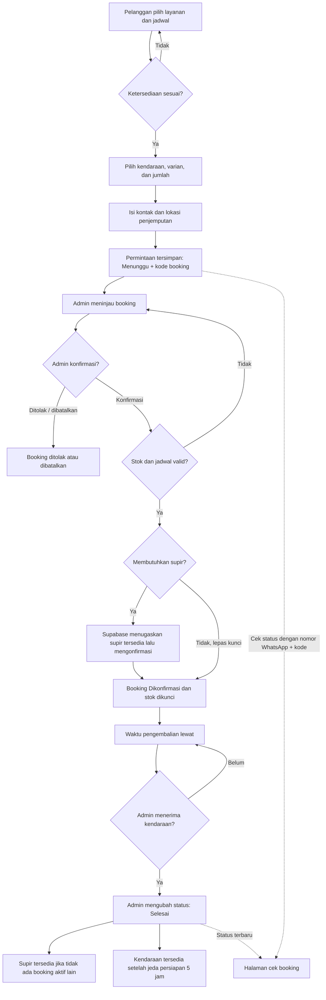

# Rencana Anggaran Biaya (RAB)
## Website Rental Mobil PT Khalisa Sumber Rezeki

**Tanggal penyusunan:** 2 Oktober 2026  
**Jenis anggaran:** Estimasi jasa pembuatan dan implementasi website, satu kali (one-time)  
**Nilai jasa:** **Rp2.500.000**  
**Status domain khusus:** Tidak termasuk

> Dokumen ini adalah estimasi penawaran jasa berdasarkan ruang lingkup fitur website yang tercantum, bukan bukti biaya historis atau invoice pembayaran. Total Rp2.500.000 hanya untuk jasa; biaya pembelian domain dan tagihan provider dibayar terpisah.

## Ringkasan Anggaran

| No. | Uraian pekerjaan | Estimasi waktu | Tarif dasar | Jumlah |
|---:|---|---:|---:|---:|
| 1 | Analisis kebutuhan dan alur bisnis | 4 jam | Rp50.000 | Rp200.000 |
| 2 | Desain UI/UX dan penyesuaian responsif | 5 jam | Rp60.000 | Rp300.000 |
| 3 | Halaman publik, katalog, dan detail kendaraan | 9 jam | Rp50.000 | Rp450.000 |
| 4 | Formulir booking, validasi, perhitungan, dan alur WhatsApp | 8 jam | Rp50.000 | Rp400.000 |
| 5 | Dashboard admin dan pengelolaan operasional | 10 jam | Rp50.000 | Rp500.000 |
| 6 | Integrasi Supabase dan kontrol akses aplikasi | 6 jam | Rp50.000 | Rp300.000 |
| 7 | Pengujian, perbaikan bug, dan pemeriksaan tampilan perangkat | 4 jam | Rp50.000 | Rp200.000 |
| 8 | Konfigurasi deployment, dokumentasi, dan serah terima | 3 jam | Rp50.000 | Rp150.000 |
|  | **Total estimasi jasa (49 jam)** |  |  | **Rp2.500.000** |

Rata-rata nilai jasa pada estimasi ini sekitar **Rp51.000 per jam**. Jam kerja merupakan dasar penyusunan anggaran, bukan pencatatan timesheet aktual.

### Pemisahan total biaya

| Komponen | Biaya dalam RAB | Keterangan |
|---|---:|---|
| Jasa analisis, desain, pembuatan, integrasi, pengujian, dan serah terima | Rp2.500.000 | Biaya satu kali sesuai rincian di atas. |
| Domain khusus, misalnya `namabisnis.com` atau `namabisnis.id` | Tidak termasuk | Pemilik membeli langsung melalui registrar. Biaya dan perpanjangan bergantung ekstensi dan registrar. |
| Vercel, Supabase, dan Geoapify | Tidak ditagihkan dalam RAB ini | Diasumsikan memakai kuota/paket yang tersedia. Tagihan berbayar, jika ada, dibayar langsung ke provider. |
| Pajak | Belum dihitung | Ditambahkan bila berlaku sesuai status penyedia jasa dan ketentuan perpajakan. |
| **Jumlah jasa yang ditawarkan** | **Rp2.500.000** | **Belum termasuk domain, tagihan provider, dan pajak yang mungkin berlaku.** |

## Rincian Lingkup Pekerjaan

### 1. Analisis kebutuhan dan alur bisnis — Rp200.000

- **Aktivitas:** inventarisasi halaman dan peran pengguna (2 jam × Rp50.000 = Rp100.000); pemetaan proses booking serta keputusan admin (1 jam × Rp50.000 = Rp50.000); penetapan daftar kebutuhan dan batas pekerjaan (1 jam × Rp50.000 = Rp50.000).
- **Hasil:** daftar halaman, kebutuhan pelanggan/admin, urutan status booking, dan batas fitur yang masuk ke estimasi.

### 2. Desain UI/UX dan penyesuaian responsif — Rp300.000

- **Aktivitas:** struktur halaman dan hierarki informasi (2 jam × Rp60.000 = Rp120.000); penataan komponen publik dan admin (2 jam × Rp60.000 = Rp120.000); penyesuaian breakpoint desktop/ponsel (1 jam × Rp60.000 = Rp60.000).
- **Hasil:** sistem tampilan yang diterapkan pada halaman publik, form booking, dan dashboard; bukan paket file desain terpisah di Figma.

### 3. Halaman publik, katalog, dan detail kendaraan — Rp450.000

- **Aktivitas:** beranda, navigasi, dan bagian informasi usaha (2 jam × Rp50.000 = Rp100.000); katalog, filter kategori, dan pengelompokan model (2 jam × Rp50.000 = Rp100.000); kartu/detail kendaraan beserta varian, stok, dan harga (3 jam × Rp50.000 = Rp150.000); halaman syarat dan ketentuan serta cek booking (2 jam × Rp50.000 = Rp100.000).
- **Rincian hasil:** pengunjung dapat menjelajahi beranda dan informasi usaha; mencari model melalui kategori; melihat foto, spesifikasi, harga, ketersediaan dan varian transmisi/mesin pada kartu atau detail kendaraan; membaca syarat sewa; serta membuka halaman cek booking.
- **Batas:** harga dan ketersediaan bergantung pada data dan konfigurasi backend Supabase yang disediakan. Pengambilan/pembuatan foto kendaraan dan penulisan konten profesional bukan bagian pekerjaan ini.

### 4. Formulir booking dan alur WhatsApp — Rp400.000

- **Aktivitas dan estimasi:**
  - Pilihan layanan, tanggal, jam, serta input durasi bulan/hari/jam dan batas minimum (2 jam × Rp50.000 = **Rp100.000**).
  - Pemilihan model, varian dan kuantitas serta kalkulasi harga per unit/subtotal (2 jam × Rp50.000 = **Rp100.000**).
  - Validasi nama dan nomor telepon, autocomplete alamat, dan opsi mengambil lokasi perangkat (2 jam × Rp50.000 = **Rp100.000**).
  - Penyimpanan permintaan dan kode booking serta penyusunan tautan WhatsApp dan Google Maps (2 jam × Rp50.000 = **Rp100.000**).
- **Rincian durasi dan harga:** satu bulan dihitung tetap 30 hari; satu hari 24 jam. Semua nilai dikonversi ke jam, lalu durasi minimum 12 jam diterapkan. Tarif tidak diubah dari tarif dasar per 12 jam dan harga booking dihitung proporsional `tarif dasar × (total jam ÷ 12)`, termasuk bila durasi bukan kelipatan 12. Contohnya, 14 jam memakai faktor `14 ÷ 12`, sedangkan 1 hari 2 jam memakai faktor `26 ÷ 12`. Paket acara tidak wajib; detail jenis acara dan add-on hanya relevan bila opsi acara dipilih.
- **Rincian lokasi:** pelanggan dapat mencari alamat di Jakarta dan sekitarnya menggunakan Geoapify, memilih hasil untuk menyimpan teks alamat dan koordinat, meminta lokasi perangkat (dengan persetujuan browser) agar koordinat dibalik menjadi alamat, atau mengetik alamat sendiri. Alamat hasil pencarian disusun ringkas dari nama tempat/jalan/area/kota/kode pos, tanpa provinsi “Jawa”; misalnya `Bundaran Taman Gondangdia 1, Jalan Teuku Umar, Menteng, Jakarta Pusat, 10350`. Tautan Google Maps memakai koordinat apabila hasil terpilih memilikinya; alamat yang diketik manual digunakan sebagai pencarian teks.
- **Hasil dan batas:** form menyimpan permintaan booking dengan data pelanggan, jadwal, durasi, pilihan armada, snapshot harga, dan lokasi. WhatsApp menjadi sarana komunikasi lanjutan; website tidak memproses pembayaran dan permintaan belum otomatis dikonfirmasi. Lokasi perangkat memerlukan izin pengguna, browser yang mendukung Geolocation API, koneksi HTTPS atau localhost, serta Geoapify API key untuk memperoleh alamat.

### 5. Dashboard admin dan pengelolaan operasional — Rp500.000

- **Aktivitas:** akses dashboard dan sesi admin (2 jam × Rp50.000 = Rp100.000); pemrosesan booking, penugasan supir, dan panel detail booking — klik baris untuk membuka modal berisi jadwal, kendaraan, penjemputan, supir, catatan, estimasi, dan ubah status (3 jam × Rp50.000 = Rp150.000); CRUD armada/foto dan profil supir (3 jam × Rp50.000 = Rp150.000); ringkasan keuangan, grafik berdasarkan tanggal mulai sewa, ekspor Excel dengan pilihan periode (per bulan atau rentang tanggal), dan pengelolaan admin (2 jam × Rp50.000 = Rp100.000).
- **Hasil:** dashboard `/admin` untuk operasional, termasuk panel detail booking interaktif, ekspor data booking ke file `.xlsx` berformat rapi dengan pilihan periode, ringkasan per supir (jumlah pesanan selesai dan total jam terjadwal), serta statistik pemakaian tiap kendaraan (jumlah booking selesai dan jam-unit terjadwal). Jam-unit armada dihitung dari durasi booking selesai dikali jumlah unit pada snapshot kendaraan; keduanya memakai jadwal, bukan pencatatan jam mesin atau jam kerja aktual. Booking hanya dapat ditandai Selesai secara manual setelah waktu pengembalian lewat dan admin memastikan kendaraan telah diterima. Supir dengan booking Menunggu atau Dikonfirmasi tidak dapat ditandai Tersedia atau Libur.
- **Periode keuangan:** ringkasan dan grafik menggunakan tanggal mulai sewa yang sama (tanggal kalender Jakarta). Saat memilih Semua, ringkasan mencakup semua booking yang memenuhi status perhitungan; grafik tetap merupakan tren 30 hari terakhir dan diberi label terpisah.

### 6. Integrasi Supabase dan kontrol akses — Rp300.000

- **Aktivitas:** konfigurasi koneksi frontend dan environment (1 jam × Rp50.000 = Rp50.000); integrasi autentikasi/role admin (1 jam × Rp50.000 = Rp50.000); alur baca/tulis katalog, booking, supir, dan foto (2 jam × Rp50.000 = Rp100.000); integrasi RPC ketersediaan, konfirmasi, dan status booking (2 jam × Rp50.000 = Rp100.000).
- **Rincian hasil:** frontend memakai Supabase URL dan anon key yang dikonfigurasi melalui environment; alur admin memakai autentikasi dan role tepercaya; katalog, booking, supir, dan foto dihubungkan ke backend; serta pemeriksaan ketersediaan kendaraan, kapasitas supir berdasarkan rentang sewa, konfirmasi, dan perubahan status menggunakan RPC. Permintaan aktif yang meminta supir tanpa penugasan ikut dihitung agar permintaan yang beririsan tidak mengklaim kapasitas supir yang sama.
- **Batas:** project Supabase harus sudah memiliki schema, RLS, bucket Storage, dan RPC status/penugasan operasional yang lama. Dua migration tambahan, `20261013000000_driver_availability_for_window.sql` dan `20261013000100_confirm_booking_with_driver.sql`, menambahkan pemeriksaan kapasitas dan konfirmasi otomatis serta harus diterapkan pada project Supabase setelah kecocokan schema diverifikasi. Migration kedua juga menolak penugasan supir pada booking lepas kunci di database, bukan hanya menyembunyikan kontrol dashboard. Karena riwayat schema lama tidak tersedia pada checkout ini, migration baru tidak merekonstruksi database produksi. Memulihkan migration schema lama, memindahkan data, serta biaya Supabase/Geoapify tidak termasuk dalam nominal jasa.

### 7. Pengujian dan perbaikan — Rp200.000

- **Aktivitas:** build dan pemeriksaan kode (1 jam × Rp50.000 = Rp50.000); pengujian alur booking/admin dan validasi dasar (2 jam × Rp50.000 = Rp100.000); pemeriksaan tampilan ponsel/desktop dan perbaikan dalam lingkup (1 jam × Rp50.000 = Rp50.000).
- **Cakupan pemeriksaan:** build frontend; alur pilih tanggal/kendaraan dan isi booking; validasi kontak/durasi; fungsi admin utama; tampilan pada layar ponsel dan desktop; serta perbaikan bug yang termasuk dalam daftar fitur.
- **Batas:** pengujian bergantung pada akses backend dan data yang tersedia. Uji penetrasi, load test, audit keamanan formal, sertifikasi aksesibilitas, dan jaminan ketersediaan layanan provider tidak termasuk.

### 8. Deployment dan serah terima — Rp150.000

- **Aktivitas:** konfigurasi build/deployment frontend (1 jam × Rp50.000 = Rp50.000); dokumentasi penggunaan dan catatan konfigurasi (1 jam × Rp50.000 = Rp50.000); serah terima source code dan akses yang disepakati (1 jam × Rp50.000 = Rp50.000).
- **Hasil:** source code, panduan admin, instruksi konfigurasi environment tanpa menyalin kredensial rahasia ke repository, dan deployment frontend sesuai akses yang tersedia. Garansi perbaikan bug yang dapat direproduksi berlaku 30 hari setelah serah terima; fitur baru atau perubahan kebutuhan dihitung terpisah. Pendaftaran domain khusus bukan bagian dari pos ini.

## Alur Kerja Website

### Alur booking dari pelanggan sampai selesai

1. **Pelanggan memilih layanan dan jadwal.** Pelanggan memilih tanggal, jam mulai, dan durasi dalam bulan, hari, jam, atau kombinasinya. Satu bulan dihitung 30 hari; tarif mengikuti harga per 12 jam secara proporsional. Untuk isian jam saja, durasi minimum adalah 12 jam. Setelah jadwal dipilih, sistem memeriksa jumlah supir yang siap untuk seluruh rentang sewa dibandingkan dengan penugasan dan permintaan aktif lain yang beririsan. Opsi **Butuh supir** hanya dapat dipilih jika kapasitas tersedia; pemeriksaan diulang sebelum permintaan dikirim. Paket acara merupakan opsi terpisah.
2. **Pelanggan memilih kendaraan.** Katalog menampilkan kendaraan dan varian yang sesuai. Pelanggan memilih transmisi/jenis mesin serta jumlah unit; harga dan subtotal dihitung sebelum permintaan dikirim.
3. **Pelanggan mengisi data dan mengirim permintaan.** Nama, nomor WhatsApp, dan lokasi penjemputan divalidasi. Lokasi dapat dipilih dari saran alamat, diambil dari posisi perangkat setelah izin browser diberikan, atau dimasukkan manual. Sistem menyimpan permintaan berstatus **Menunggu**, beserta jadwal, snapshot kendaraan/harga, dan kode booking. Tautan WhatsApp dan Google Maps disediakan untuk komunikasi lanjutan; Google Maps menggunakan koordinat jika tersedia.
4. **Admin memeriksa permintaan.** Admin meninjau jadwal, armada, dan kebutuhan supir di dashboard. Booking Menunggu belum mengunci stok kendaraan. Jika layanan supir dipilih, permintaan Menunggu ikut dihitung sebagai kapasitas supir pada jadwal beririsan meskipun nama supir belum ditetapkan.
5. **Admin mengonfirmasi atau menolak.** Saat booking dikonfirmasi, sistem memeriksa kapasitas sekali lagi. Untuk booking yang meminta supir, Supabase secara atomik memilih dan menugaskan supir yang tersedia lalu mengonfirmasi booking. Jika jadwal, stok, atau kapasitas supir bentrok, perubahan dibatalkan dan booking tetap Menunggu. Booking lepas kunci tetap tanpa supir dan tidak dapat diubah menjadi booking dengan supir.
6. **Admin mengelola penugasan bila diperlukan.** Admin tetap dapat mengganti atau melepas supir pada booking yang memang meminta supir. Sistem mencegah supir ditugaskan pada jadwal yang bertabrakan; admin dapat mengirim detail tugas melalui WhatsApp.
7. **Admin menyelesaikan booking setelah kendaraan kembali.** Setelah `end_at` lewat, admin memeriksa bahwa kendaraan telah diterima lalu mengubah status booking Dikonfirmasi menjadi **Selesai**. Melewati waktu pengembalian saja tidak mengubah status booking secara otomatis.
8. **Ketersediaan diperbarui.** Setelah booking ditandai selesai, supir yang tidak memiliki booking Menunggu atau Dikonfirmasi lain dapat kembali **Tersedia**. Kendaraan memiliki jeda persiapan **5 jam** setelah jadwal pengembalian sebelum dapat disewa lagi.
9. **Pelanggan mengecek status.** Pelanggan membuka halaman cek booking dan memasukkan nomor WhatsApp serta kode booking untuk melihat status, jadwal, kendaraan, dan estimasi biaya.

**Catatan otomatisasi:** status booking tidak otomatis berubah menjadi Selesai karena waktu berlalu; admin harus memastikan kendaraan kembali terlebih dahulu. Setelah admin menyelesaikan booking, dashboard dapat memperbarui status supir jika tidak ada booking aktif lain. Sinkronisasi supir berjalan saat dashboard dimuat/refresh atau setelah perubahan status booking, bukan melalui scheduler/server saat dashboard tertutup.

## Biaya Operasional di Luar Jasa

Biaya berikut **tidak termasuk** dalam total jasa Rp2.500.000. Nilai aktual mengikuti provider, pilihan paket, pemakaian, dan tanggal pembelian.

| Komponen | Perkiraan perlakuan biaya | Catatan |
|---|---|---|
| Domain | Biaya tahunan, mengikuti registrar dan ekstensi domain | Domain adalah biaya berulang; harga perlu dikonfirmasi sebelum pembelian. |
| Hosting frontend Vercel | Dapat mulai dari paket gratis jika memenuhi ketentuan dan kuota provider | Biaya dapat berubah jika penggunaan atau kebutuhan melewati batas paket. |
| Database, autentikasi, dan penyimpanan Supabase | Dapat mulai dari paket gratis jika memenuhi ketentuan dan kuota provider | Biaya dapat timbul untuk kapasitas atau pemakaian tambahan. Foto disimpan di Storage. |
| API pencarian dan reverse geocoding alamat Geoapify | Mengikuti kuota dan paket provider | Digunakan untuk saran alamat serta mengubah koordinat lokasi terkini menjadi alamat. Penggunaan berlebih atau kebutuhan komersial tertentu dapat dikenakan biaya. |
| WhatsApp | Tautan `wa.me` untuk membuka aplikasi WhatsApp | Bukan integrasi WhatsApp Business API; pesan otomatis tanpa klik tidak termasuk. |

## Kenapa Nilainya Bisa Rp2.500.000?

1. **Ini harga jasa dengan lingkup yang dibatasi**, bukan biaya berlangganan atau harga infrastruktur khusus. Anggaran dibagi ke delapan kelompok pekerjaan dengan estimasi 49 jam.
2. **Teknologi yang digunakan sudah tersedia dan banyak yang open source**, seperti React, Vite, Tailwind CSS, dan ExcelJS. Pengerjaan tidak memerlukan pembelian lisensi framework.
3. **Layanan backend dan hosting menggunakan platform terkelola**, yaitu Supabase dan Vercel. Pendekatan ini mengurangi kebutuhan membangun dan merawat server sendiri.
4. **Alur komunikasi WhatsApp menggunakan tautan**, bukan chatbot atau WhatsApp Business API yang memerlukan setup dan biaya tambahan.
5. **Tidak ada gateway pembayaran online** pada lingkup ini. Booking dikirim sebagai permintaan, kemudian dikonfirmasi admin.
6. **Estimasi ini mengasumsikan data, foto kendaraan, identitas merek, dan project Supabase tersedia dari pemilik.** Perancangan identitas merek, produksi foto, migrasi data besar, dan rekonstruksi backend tidak dihitung.
7. **Harga ini tergolong hemat untuk fitur yang tercantum.** Nilainya dapat tercapai dengan penggunaan komponen yang konsisten, pengerjaan langsung pada satu aplikasi, dan tanpa kebutuhan sistem enterprise atau dukungan berkelanjutan di luar masa garansi.

## Tidak Termasuk

- Pembelian domain, paket hosting berbayar, kuota API berbayar, dan biaya provider lainnya.
- Biaya pajak yang mungkin berlaku sesuai status penyedia jasa dan aturan perpajakan.
- WhatsApp Business API, notifikasi otomatis, SMS, email transaksional berbayar, atau chatbot.
- Pembayaran online, refund otomatis, invoice akuntansi, dan rekonsiliasi pembayaran.
- Aplikasi native Android/iOS, aplikasi untuk supir, GPS tracking, atau integrasi peta berbayar.
- Pembuatan konten, copywriting profesional, foto/video kendaraan, dan desain logo baru.
- Pemulihan atau pembuatan ulang migration schema lama Supabase yang tidak tersedia pada checkout ini. Checkout mencakup dua migration tambahan untuk kapasitas dan konfirmasi supir; penerapan ke project aktif tetap memerlukan verifikasi kecocokan schema dan RPC lama.
- Fitur baru, perubahan besar setelah serah terima, dan dukungan rutin setelah masa garansi.

## Asumsi dan Ketentuan

- Pemilik menyediakan akses yang diperlukan ke project Vercel, Supabase, domain, dan Geoapify. Kredensial rahasia tidak disimpan di source code publik.
- Project Supabase sudah memiliki schema, kebijakan RLS, Storage, dan RPC operasional lama yang sesuai. Konfigurasi database produksi perlu diverifikasi sebelum menerapkan dua migration tambahan yang disertakan pada checkout ini.
- Perubahan dalam masa garansi terbatas pada perbaikan bug yang dapat direproduksi pada fitur yang tercantum. Penambahan atau perubahan kebutuhan diperkirakan terpisah.
- Nilai jasa dapat berubah jika ruang lingkup, jumlah integrasi, kebutuhan keamanan, atau kebutuhan migrasi data berubah.